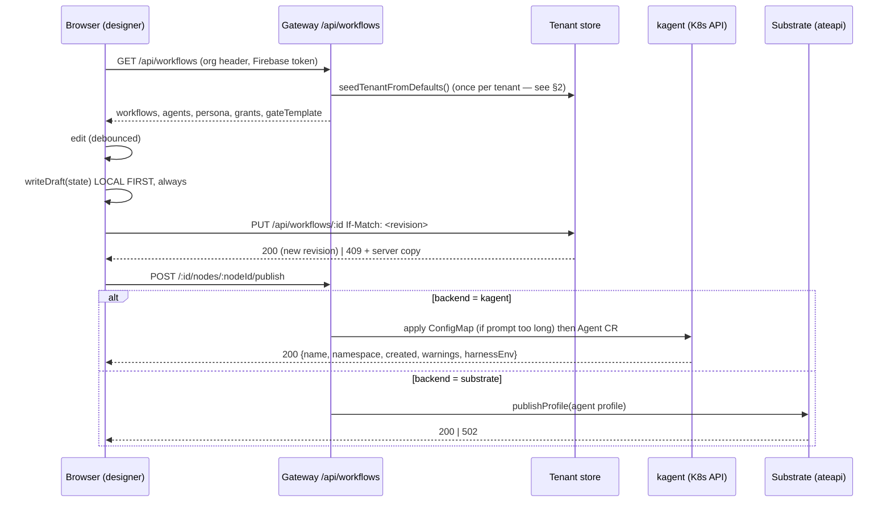

# Workflows — Application Flow

What happens between opening the canvas and a run existing in a cluster: the
read path, the write path, the gate decision, and the two publish targets.

Data shapes are in [`WORKFLOWS_DATABASE_DESIGN.md`](./WORKFLOWS_DATABASE_DESIGN.md);
who is allowed to do each step is in
[`WORKFLOWS_AUTHENTICATION.md`](./WORKFLOWS_AUTHENTICATION.md). This document is
about order and failure.

## 1. End to end



There is no session-long connection and no server-side autosave: every edit is
a local write plus a debounced revision-checked `PUT`, and the only deliberate
server action on the canvas is a publish.

## 2. First read of a tenant

`GET /api/workflows` seeds lazily, but lazily **once**:
`workflowGraphsSeededAt` in the tenant's main document records that the graph
collection has been initialized. An empty collection is not enough to decide —
it is also what "the operator deleted every graph" looks like — so a tenant with
the marker set is answered with its real emptiness instead of a fresh copy of
the platform examples.

```
marker null  + graphs  → keep the graphs, stamp the marker   (pre-marker install)
marker null  + empty   → copy platform examples, stamp
marker set   + empty   → stay empty                            (deliberate)
marker null  + empty + ?migrate=1 → stay empty, DO NOT stamp   (import window)
```

`?migrate=1` is sent by a browser that holds localStorage graphs it has not
pushed *and* may write. Without the deferral, lazy seeding would fill the
collection, `POST /import` would refuse it ("Tenant already has workflows"), and
a returning designer's local work could never reach the server.

## 3. The write path: local first, then debt

`public/js/workflow-sync.mjs` owns this and is the only writer the designer
calls. Three rules make it survive a flaky browser:

1. **Every edit writes the draft before any request.** The draft is
   `<orgKey>` in localStorage, keyed per organization so switching tenants
   cannot show another organization's canvas.
2. **What the server has not acknowledged is a debt** (`<orgKey>.pending`:
   dirty ids and deleted ids). The next load re-sends it revision-checked, so an
   interrupted save *resumes* instead of being rolled back by the load that
   follows it.
3. **Only graphs whose content actually changed are pushed.** Switching the
   active workflow, or reloading a tenant that already matches the draft, writes
   zero bytes. A read-only member writes nothing at all, even from a stale local
   draft.

A `409` is surfaced as a conflict with the server copy handed back; the local
edit stays in the draft so nothing is lost while the operator decides. Last
write wins is never applied silently.

Offline is its own state: a network-shaped failure keeps the draft and stops
calling the gateway until a reload succeeds. A `401`/`403` is **not** treated as
offline — session handling owns those, and swallowing them would look like
connectivity trouble.

## 4. Gate approval

A `gate` node is the one thing on the canvas that is a question rather than a
step. Its `gateConfig` holds up to six assessment cards, each with three
checklist items, its own `threshold`, and the `passRate` it has actually
reached.

```
met(card)      = passRate != null && passRate >= threshold
passed(gate)   = every card met            (null is never met)
overall(gate)  = mean of assessed passRates
required(gate) = mean of thresholds
```

Because each card clears **its own** bar, a 100% card cannot rescue a 60% one
whose threshold is 85. The verdict is computed by `gateVerdict()` in
`public/js/workflow-gate.mjs` — a DOM-free module, deliberately, because the
gateway validates a saved gate against the same rules and the tests must read
them without a browser. The caps themselves come from
`workflow-designer-model.mjs`, which `workflow-designer-model.parity.test.mjs`
pins against the server's copy.

Seeding a new gate copies the template's criteria and thresholds but **not its
pass rates**: those are that template's own historical review, and inheriting
them would present a brand-new gate as "all 6 cards met" with an enabled approve
button. A fresh gate reads "6 cards · 6 not assessed" and stays locked.

Edge routing carries the *approval* decision only: `normalizeEdges` keeps
`outcome` (`approved` | `rejected`) on an edge whose source node is an
`approval`, and drops it everywhere else. A gate's verdict is not an edge — it
is the `passRate`/`threshold` state an approver records in `gateConfig`, which
is why the review dialog's "Allow to move further" saves rather than rewires.
The DAG guard rejects an edge that would close a cycle, so a rejection loop
returns through a node further up the graph by *adding a step*, not by creating
a cycle.

## 5. Publish to kagent

`POST /api/workflows/:id/nodes/:nodeId/publish` renders the **saved node**, not
the browser's copy and not the agent profile, because the runtime reads the
stored graph. The browser therefore saves first and refuses to render an
unsaved graph.

The Agent name is qualified as `<graphId>-<nodeId>`: `n1` is unique inside a
graph and identical across every graph, so an unqualified name would let two
workflows overwrite one another's CR.

| Stored on the node | Becomes in the CR |
|---|---|
| `id` + graph id | `metadata.name` = `<graph>-<node>` (DNS-label), `metadata.namespace` = `KAGENT_NAMESPACE` |
| `category` | label `fleet.agent/category` |
| `harness` | `spec.harnessRef.name` (default `my-first-harness`) |
| `systemPrompt` + each binding's `promptAppend` | `spec.template.inline.systemPrompt`, **composed** in declaration order: base, then skills, then plugins, then MCP |
| composed prompt > 60 000 chars | a `ConfigMap` named `<name>-prompts` with key `SYSTEM`, referenced by `systemPromptFrom` (the two forms are mutually exclusive in the CRD) |
| `kagentSpec.modelConfig` | `spec.template.inline.modelConfig` (default `default-model-config`) |
| `kagentSpec.skills[]` | `inline.skills[]` — surfaced as **tools**, each with its mounted `source` |
| `kagentSpec.plugins[]` | `inline.plugins[]` with the skill allowlist |
| `kagentSpec.tools[]` (`mcp`) | `inline.tools[].mcp` → `{ kind: 'RemoteMCPServer', name }`, allowlist + `requireApproval` forwarded |
| `kagentSpec.tools[]` (`subAgent`) | `inline.tools[].subAgent` → `templateRef` |
| `kagentSpec.env[]` | **reported back as `harnessEnv`**, never written onto a shared Harness implicitly |
| `kagentSpec.egressPolicyRefs[]` | the Agent's egress policy references |

kagent surfaces skills as tools; it does not append their prompts, which is why
composition happens here rather than upstream. A publish answers:

- `200` with `{ name, namespace, created, warnings, harnessEnv }`;
- `503 kagent_not_configured` when the switch is off — an unconfigured cluster is
  inert, and `KAGENT_*` default dark;
- `502 kagent_spec_invalid` + the validator's errors when the stored binding
  cannot render (save-time shape problems are warnings; publish re-validates
  hard);
- `403 persona_denied` if the caller's persona may not run that node's category,
  checked on the single node before anything is applied.

`GET /api/workflows/kagent/capabilities` is the read that turns the typed-in
Harness / ModelConfig / RemoteMCPServer names into the names the namespace
actually holds. It answers even when kagent is off, and a refused read is
*remembered* for the session rather than retried on every inspector repaint —
retry-on-redraw measured ~3,700 requests in a single spec. "Read the cluster
again" retries on demand.

## 6. Publish to substrate

The same endpoint, `backend: 'substrate'`. Here the node contributes only its
place in the graph: an actor runs the **curated agent profile** behind
`node.refId`, so the publish calls `substrateAdapter.publishProfile(profile)`.
A missing profile is `404`, and an unconfigured substrate is
`503 substrate_not_configured`. Substrate remains the default backend, so
nothing changes for an install that never touches kagent.

## 7. Running a published agent

Publishing makes the definition exist; starting a run is a separate surface. The
planner's `/kagent/status` and `/runtime/:backend/run` routes are **not wired
yet** — they are on hold pending the planner→orchestrator retirement decision,
and adding them to a service that may be retired would land the same routes
twice. Until then the live-cluster check is direct:

```
kubectl get agents.api.kagent.dev -n <KAGENT_NAMESPACE> -o yaml
```

## 8. Failure loop, in one table

| Symptom | Cause | What the client does |
|---|---|---|
| `409 revision_conflict` | a teammate saved first | shows the conflict, keeps the local draft, offers the server copy |
| `403 persona_denied` + violations | the persona is not granted a category in the graph | writes nothing further for that graph; the violation list is the message |
| `404` on a known id | the graph belongs to another organization | same as "not found" — cross-org reads cannot exist |
| `503 kagent_not_configured` | switch off / no cluster address | the inspector keeps the binding, the button says why |
| `502` with `errors[]` | stored binding cannot render | surfaces each validator error; the graph is still saved |
| network failure | offline | draft + debt retained, writes paused until a load succeeds |
| import `skipped` | tenant already has graphs | takes the server copy; local graphs remain in the draft |

## Related documents

- [`WORKFLOWS_DATABASE_DESIGN.md`](./WORKFLOWS_DATABASE_DESIGN.md) — collections, doc shapes, caps, seeding marker
- [`WORKFLOWS_AUTHENTICATION.md`](./WORKFLOWS_AUTHENTICATION.md) — middleware chain, authz matrix, cluster RBAC
- [`SUBSTRATE_INTEGRATION.md`](./SUBSTRATE_INTEGRATION.md) — the substrate side in full
- [`GCP_DEPLOY.md`](./GCP_DEPLOY.md) — `KAGENT_*` / `SUBSTRATE_*` provisioning
